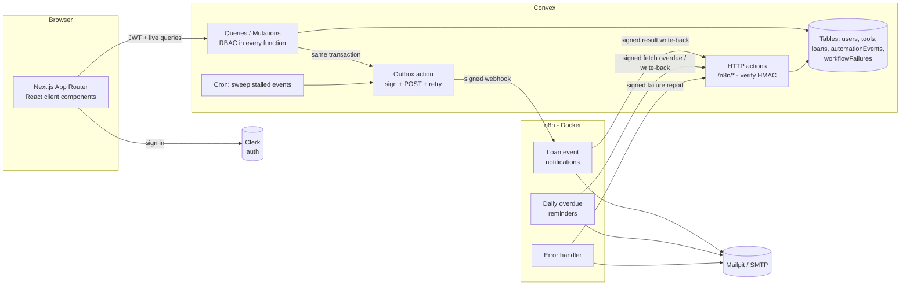

# LendLoop

> Borrow what you need. Lend what you don't.

A neighborhood tool-lending board. Neighbors list tools, request to borrow them for a date range, approve or decline requests, and get notifications and overdue reminders from **n8n** workflows.

**Stack:** Next.js 16 (App Router) · Clerk · Convex · n8n (self-hosted, Docker) · TypeScript · Tailwind CSS v4

---

## Contents

- [Features](#features)
- [Local setup](#local-setup)
- [Environment variables](#environment-variables)
- [Architecture](#architecture)
- [Roles and access control](#roles-and-access-control)
- [n8n workflows](#n8n-workflows)
- [Security and data-minimization decisions](#security-and-data-minimization-decisions)
- [Reliability and error handling](#reliability-and-error-handling)
- [Testing](#testing)
- [What I'd change for production](#what-id-change-for-production)
- [Project structure](#project-structure)

---

## Features

**Public page (`/`)**
- Tagline and a read-only list of tools available right now: **name and category only**, rendered on the server from a public Convex query.
- "Sign in to lend or borrow" button (Clerk).

**Signed-in experience**
| Page | What you can do |
|---|---|
| **All tools** (`/board`) | Browse every listing with live availability (available / on loan / overdue / upcoming booking), filter by category, search, and request a date range |
| **My listings** (`/listings`) | List, edit and delete your own tools (name, category, condition, short description) |
| **My requests** (`/requests`) | Track your requests, withdraw pending ones, cancel upcoming bookings |
| **Incoming** (`/incoming`) | Approve or decline requests for your tools, mark loans as returned. Overdue loans are highlighted |
| **Admin** (`/admin`) | Remove any listing, view all loans, mark Trusted Lenders, and an **Automation health** panel (failed notifications with one-click retry, failed n8n runs) |

**Automation activity on every loan (bonus):** each loan card shows recent automation events, such as *"Lender notified about the new request · 5 minutes ago"* or *"Reminder sent 2 days ago"*.

---

## Local setup

**Prerequisites:** Node 20+, pnpm, Docker, and a free [Clerk](https://clerk.com) account. A Convex account is optional, because Convex can run a local backend.

### 1. Install

```bash
pnpm install
```

### 2. Clerk

1. Create a Clerk application (email and/or Google sign-in).
2. In **Configure → JWT templates**, create a template from the **Convex** preset. Keep its name as `convex`. The preset includes the `name` and `email` claims LendLoop uses.
3. Copy the **API keys** into `.env.local` (see `.env.example`):
   ```bash
   NEXT_PUBLIC_CLERK_PUBLISHABLE_KEY=pk_test_...
   CLERK_SECRET_KEY=sk_test_...
   ```
4. Note your **Frontend API URL** (e.g. `https://your-app-12.clerk.accounts.dev`). This is the JWT issuer.

### 3. Convex

```bash
# Option A: local backend, no account needed. Recommended here, because n8n in Docker
# can reach it and it can reach n8n on localhost.
CONVEX_AGENT_MODE=anonymous npx convex dev

# Option B: a Convex cloud dev deployment
npx convex dev
```

Either way this writes `NEXT_PUBLIC_CONVEX_URL` to `.env.local` and keeps pushing functions as you edit. In another terminal:

```bash
npx convex env set CLERK_JWT_ISSUER_DOMAIN https://your-app-12.clerk.accounts.dev
```

> If you use a **cloud** deployment, Convex can't reach `localhost:5678`. Expose n8n with a tunnel (for example `cloudflared tunnel --url http://localhost:5678`), pass that URL as `N8N_WEBHOOK_URL` in the next step, and set `LENDLOOP_CONVEX_SITE_URL` in `n8n/.env` to your `https://<name>.convex.site` URL.

### 4. Wire Convex and n8n together

```bash
scripts/setup-local.sh
```

The script creates `n8n/.env` with three freshly generated secrets: the n8n encryption key and the two HMAC secrets. It then pushes the matching values to the Convex deployment through stdin, so they never appear on the command line. You can do the same by hand by copying `n8n/.env.example` and running `npx convex env set`.

### 5. Start n8n and Mailpit

```bash
docker compose up -d
```

- **n8n:** http://localhost:5678. Create the owner account on first visit.
- **Mailpit:** http://localhost:8025. Every email n8n sends lands here; nothing leaves your machine.

On first start, a one-shot `n8n-init` container creates the **LendLoop SMTP** credential from env vars and imports and publishes the three workflows from `n8n/workflows/`. After editing workflow JSON, re-import with `docker compose run --rm -e N8N_FORCE_REIMPORT=true n8n-init` followed by `docker compose restart n8n`.

### 6. Run the app

```bash
pnpm dev     # http://localhost:3000
```

### 7. Make yourself an admin and try it out

```bash
# Sign in once first so your user exists in Convex, then:
npx convex run users:setRole '{"email":"you@example.com","role":"admin"}'

# Optional demo data, including an overdue loan for the reminder workflow:
npx convex env set ALLOW_DEMO_SEED true
npx convex run seed:demo
```

To see the overdue reminder without waiting for 09:00, open **LendLoop · Daily overdue reminders** in n8n and click **Execute workflow**. Then check Mailpit, and the loan's activity in the app.

---

## Environment variables

There are three separate places for config. No secret lives in code or in the workflow JSON.

**Next.js (`.env.local`)**
| Variable | Purpose |
|---|---|
| `NEXT_PUBLIC_CONVEX_URL` | Convex client URL (written by `npx convex dev`) |
| `NEXT_PUBLIC_CLERK_PUBLISHABLE_KEY` | Clerk publishable key |
| `CLERK_SECRET_KEY` | Clerk secret key (server only) |

**Convex deployment (`npx convex env set …`)**
| Variable | Purpose |
|---|---|
| `CLERK_JWT_ISSUER_DOMAIN` | Clerk issuer. Convex verifies JWTs against its JWKS |
| `LENDLOOP_TO_N8N_SECRET` | HMAC secret Convex uses to **sign** webhooks to n8n |
| `N8N_TO_LENDLOOP_SECRET` | HMAC secret Convex uses to **verify** calls from n8n |
| `N8N_LOAN_EVENTS_WEBHOOK_URL` | n8n production webhook URL for loan events |
| `SITE_URL` | App URL, used for links in notifications |
| `ALLOW_DEMO_SEED` | `true` enables `seed:demo` (dev only) |

**n8n (`n8n/.env`, git-ignored; template in `n8n/.env.example`)**
| Variable | Purpose |
|---|---|
| `N8N_ENCRYPTION_KEY` | Encrypts credentials in n8n's database |
| `LENDLOOP_TO_N8N_SECRET` / `N8N_TO_LENDLOOP_SECRET` | Same values as on Convex |
| `LENDLOOP_CONVEX_SITE_URL` | Convex HTTP actions URL (`…convex.site`, or `http://host.docker.internal:3211` locally) |
| `LENDLOOP_NOTIFY_FROM`, `LENDLOOP_OPS_EMAIL` | Sender address, and where failure alerts go |
| `SMTP_HOST`, `SMTP_PORT`, `SMTP_SECURE`, `SMTP_USER`, `SMTP_PASS` | Used once to create the encrypted **LendLoop SMTP** n8n credential. Defaults point at Mailpit |

---

## Architecture



**Key design choices**

- **Convex is the single source of truth** for data *and* authorization. Next.js is a thin client: pages are client components using live Convex queries, so lists update in real time when a neighbor approves or returns something. The public landing page is server-rendered with `preloadQuery` on a deliberately minimal public query.
- **Clerk handles identity, Convex handles authorization.** Clerk issues a JWT that Convex verifies. A `users` row is upserted from the verified claims on sign-in. **Roles live in Convex**, not in Clerk metadata or the UI, and can only be changed through an internal function, so no client-reachable code path can escalate privileges.
- **Transactional outbox for notifications.** A status change and its `automationEvents` row are written in the *same* Convex mutation, so an event exists if and only if the change committed. A scheduled action then delivers it to n8n. Nothing is lost if n8n is down, and no notification goes out for a change that rolled back.
- **One `automationEvents` table** serves as outbox, idempotency ledger (`eventKey`), and audit log. It also powers the per-loan activity feed and the admin health panel.
- **Calendar dates as `YYYY-MM-DD` strings (UTC)**, compared lexicographically. Overlap checks prevent double-booking. Approving a request auto-declines overlapping pending ones (and notifies those borrowers).
- **Soft deletes for listings** (`removedAt` / `removedBy`), so loan history stays intact and there's an audit trail of admin removals.

**Data model** (`convex/schema.ts`)

| Table | Notes |
|---|---|
| `users` | `tokenIdentifier` (from JWT), `name`, `email`, `role` (`admin`/`user`), `trustedLender` |
| `tools` | `ownerId`, `name`, `category`, `condition`, `description`, `removedAt?` |
| `loans` | `toolId`, `borrowerId`, `lenderId` (denormalized for one-read auth checks), `startDate`, `endDate`, `status` (`pending → approved → returned`, or `declined`/`cancelled`), reminder counters |
| `automationEvents` | `kind` (`request_notification`/`overdue_reminder`), `eventKey` (unique idempotency key), `status` (`pending → delivered → sent`, or `failed`), `attempts`, `lastError` |
| `workflowFailures` | Failed n8n executions reported by the error workflow (unique by `executionId`) |

---

## Roles and access control

Every public Convex function starts with a guard from `convex/lib/auth.ts` (`requireUser`, `requireAdmin`, `requireToolOwner`, `requireLender`, `requireBorrower`). The UI hides buttons for convenience only. `src/proxy.ts` (Clerk middleware) redirects signed-out users away from app pages, but that's UX, not security.

| Action | Anonymous | User | Admin |
|---|:-:|:-:|:-:|
| See available tools (name + category) | ✅ | ✅ | ✅ |
| See full board (description, owner first name, availability) | ❌ | ✅ | ✅ |
| Create a listing | ❌ | ✅ | ✅ |
| Edit a listing | ❌ | own only | own only |
| Delete / remove a listing | ❌ | own only | **any** |
| Request to borrow | ❌ | others' tools | others' tools |
| Approve / decline / mark returned | ❌ | requests for own tools | requests for own tools |
| Withdraw / cancel a request | ❌ | own requests | own requests |
| View loans | ❌ | ones they're part of | **all** |
| Mark Trusted Lender | ❌ | ❌ | ✅ |
| Change roles | ❌ | ❌ | ❌ (CLI / dashboard only: `users:setRole`) |

Admins deliberately **can't edit** other people's listings (moderation means removal, not rewriting someone's words) and don't act on loans they aren't part of. These rules are covered by tests (`tests/rbac.test.ts`).

---

## n8n workflows

Exported JSON lives in `n8n/workflows/`. It contains no secrets: workflows read secrets via `$env`, and SMTP via an encrypted n8n credential referenced by id. Each workflow has a sticky note explaining it.

### 1. Loan event notifications (`loan-event-notifications.json`)

```
Webhook (raw body) → Verify HMAC ─ invalid → 401
                         └ valid → 202 Accepted → Drop duplicates (dedupeKey) → Compose message
                                 → Send email (3 tries), or log a mock notification if no email is on file
                                 → Sign result (sent / failed) → POST /n8n/notification-result (3 tries)
```
- Triggered when a request is **created, approved, declined, cancelled, or returned**. The recipient is whoever needs to act or know: the lender for new requests and withdrawn requests; the borrower for approvals, declines, returns, and bookings cancelled because a listing was removed.
- The signature is verified over the **raw** body with a constant-time compare and a 5-minute timestamp window.
- n8n acknowledges with **202** right after verification. From then on, delivery is n8n's job (node retries plus the error workflow). Convex just needs to know n8n has the event.
- Duplicate deliveries (for example, Convex retrying after a lost response) are dropped by n8n's *Remove Duplicates* node, keyed on `dedupeKey` = `eventId:generation`. An admin "retry" bumps the generation so it isn't treated as a duplicate.
- The outcome (`sent`/`failed`) is written back to Convex, and the UI shows it on the loan.

### 2. Daily overdue reminders (`overdue-reminders.json`)

```
Schedule (09:00 daily) ┐
Run manually ──────────┴→ Sign → POST /n8n/overdue-loans (3 tries) → split per loan → Compose reminder
   → has email? → Send email (3 tries) / log mock → result → Sign → POST /n8n/reminder-result (3 tries)
```
- Convex returns only approved, unreturned loans whose end date has passed, **excluding loans already reminded today**. Re-running the workflow the same day never sends a second reminder.
- Write-backs are keyed by `reminderKey = reminder:<loanId>:<YYYY-MM-DD>`. A retried write-back returns `{duplicate: true}` and changes nothing. A failed reminder is recorded as such, and the next daily run retries it.

### 3. Error handler (`error-handler.json`)

Configured as the *Error workflow* of the other two. On any failed execution (for example, Convex unreachable after retries, or a bug in a Code node) it:
1. logs a structured summary,
2. emails ops (`LENDLOOP_OPS_EMAIL`, caught by Mailpit locally),
3. reports the failure to Convex (`/n8n/workflow-failure`, de-duplicated by execution id), where it appears in **Admin → Automation health**.

---

## Security and data-minimization decisions

**Authentication and authorization**
- Clerk JWTs are verified by Convex on every call. Identity comes from `ctx.auth`, never from arguments.
- RBAC is enforced in Convex functions, with a small set of shared guards and tests for each rule.
- Roles can't be set from any client-reachable function (`users.store` always creates `role: "user"`). Promotion is an operator action (`npx convex run users:setRole`) that leaves an audit log line.
- Server-side validation of every input: enums via Convex validators, length limits, date validity, ranges (max 30-day loans, booking at most 90 days ahead), overlap checks, a cap on pending requests per borrower, and no borrowing your own tool.
- Internal functions (`internal.*`) back the HTTP endpoints and seed script and are not callable from the browser. The seed also refuses to run unless `ALLOW_DEMO_SEED=true`.

**Integration security (both directions)**
- **HMAC-SHA256 signatures** over `timestamp.rawBody`, sent as `X-LendLoop-Signature: v1=<hex>` plus `X-LendLoop-Timestamp`. Verification uses a constant-time compare, and requests older than 5 minutes are rejected to limit replay.
- **Separate secrets per direction** (`LENDLOOP_TO_N8N_SECRET`, `N8N_TO_LENDLOOP_SECRET`), so leaking one doesn't let an attacker forge the other direction.
- Every n8n→Convex call is a POST whose body `type` must match the endpoint, so a captured signature can't be replayed against a different operation. Bodies are size-limited, fields are validated, and IDs are normalized with `ctx.db.normalizeId`. Rejections return a generic `401 invalid signature`; the specific reason is only logged server-side.
- Secrets live in env vars (`n8n/.env`, the Convex deployment env) and the encrypted n8n credential store. The exported workflow JSON contains only `$env.*` references and a credential id. `scripts/setup-local.sh` passes secrets to Convex through stdin, not argv.
- Ports in `docker-compose.yml` bind to `127.0.0.1` only.

**Data minimization**
- **Public page:** the public query returns only `{ id, name, category }` for currently available tools. No owners, descriptions or loan data, because descriptions might contain personal details.
- **Signed-in views:** other people appear by **first name only**. No surnames, emails or user ids reach the browser. Admins see a masked email (`a•••@example.com`) on the Lenders tab and don't see the private note a borrower writes to a lender.
- **n8n payloads** carry only what the message needs: the recipient's first name and *their own* email, the other party's first name, tool name, dates and status. The borrower's free-text note, other users' emails and internal user ids never leave Convex (asserted in `tests/automation.test.ts`).
- **n8n execution data** (which includes names and emails) is pruned after 14 days (`EXECUTIONS_DATA_MAX_AGE`). Error reports to Convex contain the workflow name, node and a truncated message, not payloads.
- Responses from `/n8n/*` use `Cache-Control: no-store`. The Next.js app sends `X-Frame-Options: DENY`, `nosniff`, a strict referrer policy, HSTS and a Permissions-Policy.

**Known trade-off:** n8n Code nodes read the HMAC secrets through `$env`, which requires `N8N_BLOCK_ENV_ACCESS_IN_NODE=false`. On a shared n8n instance, that means anyone who can edit workflows can read those env vars. For production see below (external secrets / a dedicated signing service).

---

## Reliability and error handling

| Failure | What happens |
|---|---|
| n8n down or slow when a loan changes | The outbox action retries with exponential backoff and jitter (30s → 1m → 2m → 4m, 10s timeout per attempt). After 5 attempts the event is marked `failed`: shown on the loan and in Admin → Automation health, with a **Retry** button |
| Convex action crashes mid-delivery | A cron (every 5 minutes) re-dispatches `pending` events whose lease expired |
| Convex retries a delivery n8n already got | n8n drops it by `dedupeKey`, so nobody is notified twice |
| SMTP fails | The email node retries 3× and then routes to its error output. `failed` is written back to Convex and shown on the loan |
| Convex unreachable from n8n | HTTP nodes retry 3×, then the execution fails and the error workflow emails ops (and also tries to report the failure to Convex) |
| Reminder write-back retried, or workflow re-run | Idempotent by `reminderKey`; already-reminded loans are excluded from the fetch |
| Bad, missing or stale signature | Rejected with 401 on both sides. Convex-side, a 401 from n8n counts as a failed attempt, so misconfiguration becomes visible |

Business errors are `ConvexError({ code, message })`. The UI shows the message in a toast, and the codes (`UNAUTHENTICATED`, `FORBIDDEN`, `NOT_FOUND`, `INVALID_INPUT`, `CONFLICT`) keep handling consistent.

---

## Testing

```bash
pnpm test        # Convex functions, RBAC, HTTP endpoints, signing (vitest + convex-test)
pnpm typecheck
pnpm lint
```

`tests/` covers authentication, the RBAC rules above, input and date validation, overlapping bookings, the public query's field allow-list, HMAC verification (tampering, wrong secret, stale timestamp), endpoint type binding, idempotent reminder write-backs, failure de-duplication, outbox backoff ending in `failed`, and the exact fields of the n8n payload.

I also verified the full loop by hand against the Docker stack: request → signed webhook → email in Mailpit → `sent` written back; forged and stale signatures get 401; duplicate deliveries send one email; the overdue workflow reminds once per day; SMTP outage → `failed` on the loan; a broken execution → ops email plus an Automation health entry; and admin retry → delivered.

---

## What I'd change for production

- **Hosting:** Vercel for Next.js and a Convex production deployment. n8n on n8n Cloud, or self-hosted in queue mode (Postgres plus Redis workers) behind TLS, with the editor behind SSO/VPN and only `/webhook/*` exposed.
- **Secrets:** n8n external secrets (AWS Secrets Manager or Vault) instead of `$env`, with `N8N_BLOCK_ENV_ACCESS_IN_NODE` back on, or a tiny signing service. Rotate secrets by accepting two signatures during a transition (`v1=…,v1=…`).
- **Notifications:** a transactional email provider (SES or Postmark) with verified domain, SPF/DKIM, unsubscribe preferences and bounce handling. Per-user notification settings.
- **Abuse and rate limits:** rate-limit mutations per user (for example with the Convex rate-limiter component) and HTTP endpoints per IP. Add CAPTCHA and bot protection on sign-up (Clerk). Add a nonce cache to make webhook replays strictly one-time.
- **Observability:** Sentry for the app and Convex errors, Convex log streaming to Datadog, and alerts on a growing outbox backlog or `failed` events, plus a heartbeat for the daily reminder run (alert if it doesn't run).
- **Data and privacy:** a retention policy (purge old loans and automation events), user data export and deletion (handled via a Clerk `user.deleted` webhook), Convex audit logs for admin actions in a dedicated table instead of log lines, and a CSP header.
- **Scale:** pagination and indexes for the board and admin lists (currently capped at a few hundred rows), a denormalized availability field instead of per-tool lookups, and neighborhood or community scoping, so the board shows nearby tools only.
- **Time zones:** store each community's time zone. Today "overdue" is computed in UTC and the reminder runs at 09:00 `GENERIC_TIMEZONE`.
- **CI:** run lint, typecheck and tests on every PR, import the workflow JSON into a throwaway n8n for a smoke test, and deploy with `npx convex deploy` from CI only.

---

## Project structure

```
convex/
  schema.ts            data model + indexes
  lib/auth.ts          RBAC guards, ConvexError helpers, display-name minimization
  lib/signing.ts       HMAC sign/verify (Web Crypto, constant-time compare, replay window)
  lib/availability.ts  derived tool availability
  users.ts             user upsert from JWT, me, internal setRole
  tools.ts             public list, board, CRUD (owner-only edits, admin removal)
  loans.ts             request / approve / decline / cancel / return
  admin.ts             all loans, listings, trusted lenders, automation health
  notifications.ts     transactional outbox → n8n (sign, deliver, backoff, sweep)
  automation.ts        internal functions behind the n8n endpoints (idempotent write-backs)
  http.ts              signed HTTP endpoints for n8n
  crons.ts             outbox sweeper
  seed.ts              dev-only demo data
src/
  app/page.tsx         public landing (server-rendered public query)
  app/(app)/…          board, listings, requests, incoming, admin
  components/…         UI primitives, loan card, activity feed, forms
  proxy.ts             Clerk middleware (UX redirect for app routes)
n8n/
  workflows/*.json     exported workflows (no secrets)
  init.sh              bootstrap: SMTP credential from env + import/publish workflows
  .env.example
tests/                 vitest + convex-test
docker-compose.yml     n8n + bootstrap + Mailpit
scripts/setup-local.sh generate secrets, configure Convex env
```
